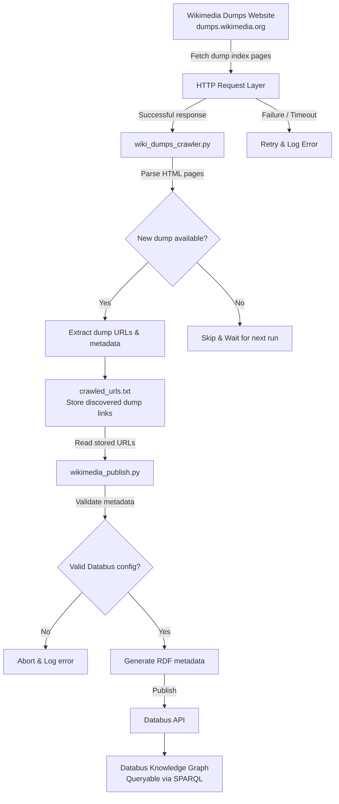

# wikimedia-dumps

Project content credit: [Sebastian Hellmann](https://forum.dbpedia.org/t/automatically-adding-wikimedia-dumps-on-the-databus-gsoc-2025/4253)
### Project Description:

Wikimedia publishes their dumps via https://dumps.wikimedia.org . At the moment, these dumps are described via HTML, so the HTML serves as the metadata and it is required to parse to identify whether new dumps are available. To automate retrieval of data, the Databus (and also MOSS as its extension [Databus and MOSS – Search over a flexible, multi-domain, multi-repository metadata catalog](https://zenodo.org/records/14161466)) has a metadata knowledge graph, where one can do queries like “check whether a new version of x is available”. Since DBpedia uses the dumps to create knowledge graphs, it would be good to put the download links for the dumps and the metadata on the Databus.

### Key Objectives

* Build a docker image that we can run daily on our infrastructure to crawl dumps.wikimedia.org  and identify all new finished dumps, then add a new record on the Databus.
* Goal is to allow checking for new dumps via SPARQL. go to OIDC Form_Post Response  , then example queries, then “Latest version of artifact”.
* this would help us to 1. track new releases from wikimedia, so the core team and the community can more systematically convert them to RDF as well as to 2. build more solid applications on top, i.e. DIEF or other
* process wise I would think that having an early prototype is necessary and then plan iterations from this.

### Architecture Overview

The following diagram illustrates the high-level workflow of the Wikimedia Dumps automation pipeline, from crawling Wikimedia dump pages to publishing metadata on the Databus for SPARQL-based querying.



##  Project Setup Guide

###  Prerequisites

1. Python **3.13.0**
2. Git
3. WSL (Optional, for Linux-based environment support)


###  Setup Instructions

#### Step 1: Clone the Repository

Make sure to fork the repository first, then clone your fork:

```bash
git clone https://github.com/YOUR_USERNAME/wikimedia-dumps.git
cd wikimedia-dumps
```

#### Step 2: Switch to the `dev` Branch

Ensure you are on the development branch:

```bash
git checkout dev
```

#### Step 3: Verify Directory

Make sure your working directory ends with `wikimedia-dumps`:

```bash
pwd  # should end with /wikimedia-dumps
```

#### Step 4: Set Up Python Environment

Create and activate a virtual environment, then install dependencies:

```bash
python -m venv .venv
source .venv/bin/activate  # For Linux/macOS or WSL
# .venv\Scripts\activate    # For Windows

pip install -r requirements.txt
```

#### Step 5: Run the Crawler

Starting the Wikimedia dumps crawler script:

```bash
python wiki_dumps_crawler.py
```
#### Step 6 Create .env file 
```
DATABUS_API_KEY='your-api-key'
```

#### Step 7: Run Publishing Script
After the crawler finishes, all discovered links are saved in the crawled.txt file.

To start the publishing process, run:

```bash
python wikimedia_publish.py
```


